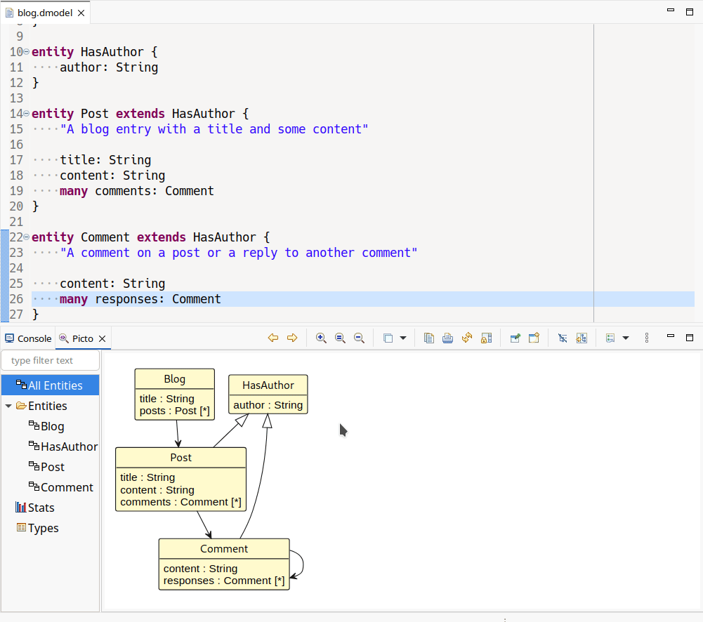

# Visualising Xtext Models with Picto

This article shows how [Picto](../../picto/index.md) can be used to produce graphical views from Xtext-based models. To demonstrate the Picto/Xtext integration, we use the Entity DSL showcased in the [15' Xtext tutorial](https://www.eclipse.org/Xtext/documentation/102_domainmodelwalkthrough.html).



## Setup

- This example requires an Eclipse installation with Epsilon, Xtext, and the required plugins to run a nested Eclipse instance. If unsure of how to achieve this, a simple way is to [obtain Epsilon via the Eclipse installer](../../../download/index.md#development-tools).
- Import the projects below from the `examples` folder of the [Epsilon Git repository](https://github.com/eclipse-epsilon/epsilon/tree/main/examples)
    - `org.eclipse.epsilon.examples.picto.xtext.domainmodel`
    - `org.eclipse.epsilon.examples.picto.xtext.domainmodel.ide`
    - `org.eclipse.epsilon.examples.picto.xtext.domainmodel.ui`
    - `org.eclipse.epsilon.examples.picto.xtext.domainmodel.picto`
- Right-click on `Domainmodel.xtext` and select `Run As` --> `Generate Xtext Artefacts`
- Run a nested Eclipse instance (right-click on any of the project, `Run As` --> `Eclipse Application`).
- In the nested Eclipse instance workspace, import the `org.eclipse.epsilon.examples.picto.xtext.domainmodel.example` project, which has a file named `blog.dmodel` with the content below:

```graphql
{{{ example("org.eclipse.epsilon.examples.picto.xtext.domainmodel.example/blog.dmodel", true) }}}
```

- Open the Picto view from the Window --> Show View menu.
- Go through the produced graphical views as shown in the image above.

## The Picto-Xtext Integration Plugin Project

We now dive into the `org.eclipse.epsilon.examples.picto.xtext.domainmodel.picto` project which contains the Picto-Xtext integration code (the rest of the projects are standard Xtext projects).

### The DmodelPictoSource class

This class extends Picto's built-in `EglPictoSource` class and produces graphical views in Picto from `*.dmodel` files edited in an Xtext-based editor. In particular:

- The `supportsEditorType` method specifies that this class contributes visualisation capabilities to Xtext-based editors, the title of which ends with `.dmodel`
- The `getRenderingMetadata` method specifies the [EGL](../../egl.md) transformation that produces the graphical views every time an editor of interest is opened, activated or saved.
- The `getFile` and `getResource` methods extract an `IFile` and an EMF `Resource` from the editor of interest and should be reusable without changes for other Xtext-based languages too.
- The `showElement` method reveals and highlights the element with the specified `id` in the Xtext editor, enabling [navigation back to the source model](#interactive-diagrams) of the view.

```java
{{{ example("org.eclipse.epsilon.examples.picto.xtext.domainmodel.picto/src/org/eclipse/epsilon/examples/picto/xtext/domainmodel/picto/DmodelPictoSource.java", false) }}}
```

Picto is made aware of this class through the `org.eclipse.epsilon.picto.pictoSource` [extension](../../picto/index.md#extending-picto) in the project's `plugin.xml`.

```xml
{{{ example("org.eclipse.epsilon.examples.picto.xtext.domainmodel.picto/plugin.xml", false) }}}
```

### The Visualisation Transformation

The main visualisation transformation has been implemented using Epsilon's [EGL model-to-text transformation language](../../egl.md) and produces [Plantuml-based class diagrams](https://plantuml.com/class-diagram) from the active entity model. The transformation consists of the `dmodel.egx` coordination rules, and the `entity2plantuml.egl` template shown below. The first transformation rule (`AllEntities`) produces a general view for the whole domain model. The second rule (`Entity2PlantUML`) generates an individual view for each entity in the model with the entity itself, any super/sub-types it may have, as well as other entities that it is related to. The individual views are placed in the `Entities` folder in Picto's view tree.

=== "dmodel.egx"

    ```egx
    {{{ example("org.eclipse.epsilon.examples.picto.xtext.domainmodel.picto/picto/dmodel.egx", true) }}}
    ```

=== "entity2plantuml.egl"

    ```egl
    {{{ example("org.eclipse.epsilon.examples.picto.xtext.domainmodel.picto/picto/entity2plantuml.egl", true) }}}
    ```

=== "barchart.egl"

    ```egl
    {{{ example("org.eclipse.epsilon.examples.picto.xtext.domainmodel.picto/picto/barchart.egl", true) }}}
    ```

=== "typeStats.pinset"

    ```pinset
    {{{ example("org.eclipse.epsilon.examples.picto.xtext.domainmodel.picto/picto/typeStats.pinset", true) }}}
    ```

The visualization includes the following two extra views/transformations:

- A `Stats` view that contains a chartjs barchart with counts of data types, entities and features in the domain model. This showcases how Picto can also target available web libraries by generating plain html, css and javascript via EGL (`barchart.egl`).
- A table-based visualization of the `Types` usage in the model (either entities or data types), created using the `typeStats.pinset` template. Pinset is an Epsilon language that allows [extracting tabular datasets from models](../../pinset/).

### Interactive Diagrams

As shown below, you can navigate between PlantUML diagrams and back to the Xtext editor using Picto's built-in `showElement` and `showView` [JavaScript functions](../../picto/index.md#interactive-diagrams).


### Lazy Execution

Since Picto executes [EGL transformations lazily](../../picto/index.md#scalability) when the entity model is saved, only the view that is currently visible is regenerated immediately, which is useful when working with large models.